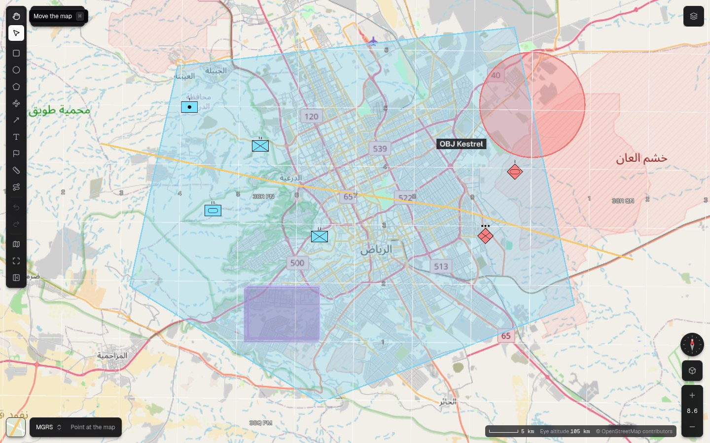
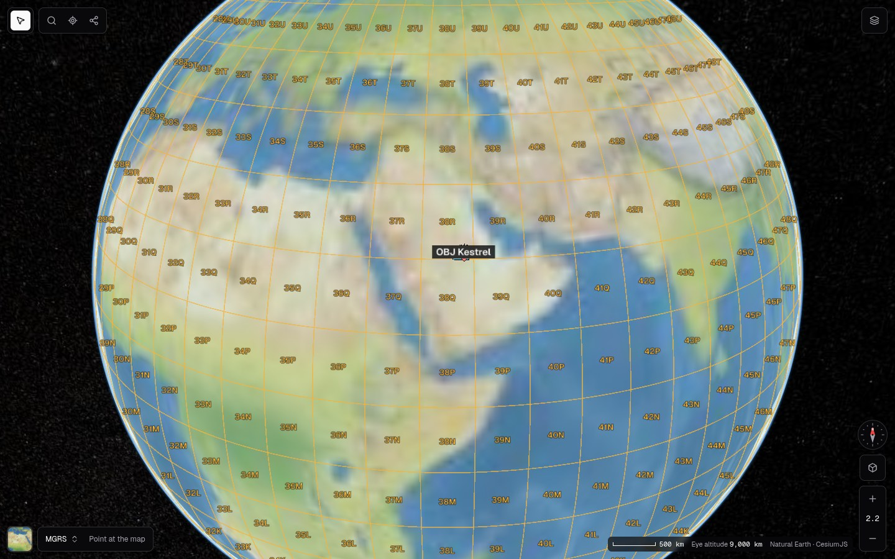
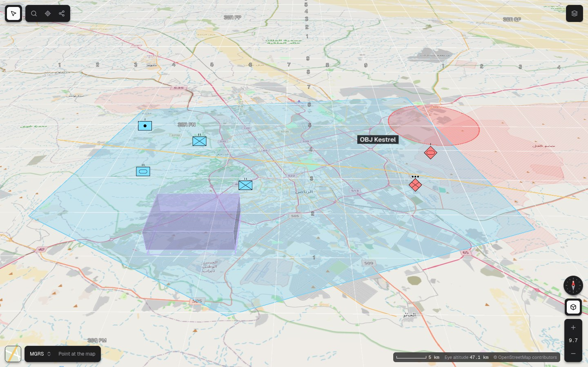
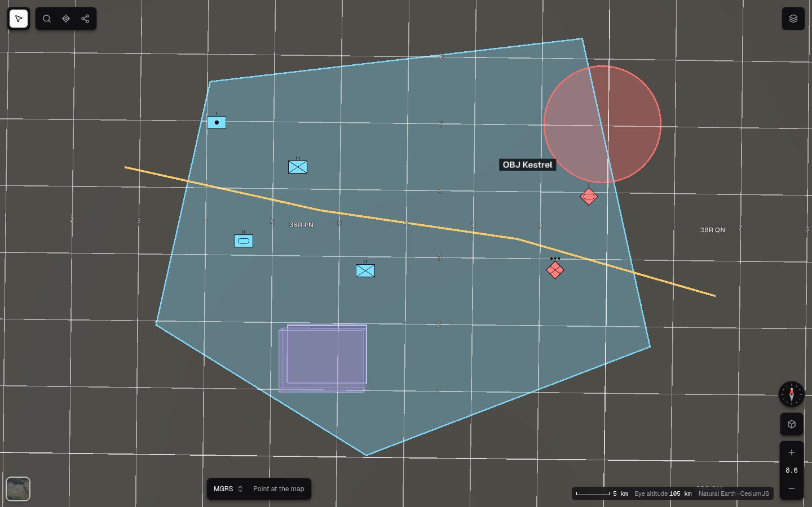

# rsGIS

An open-source GIS built in Rust. It shows a 3D globe and flat map that work offline, with an MGRS grid, military symbols (MIL-STD-2525C), drawing and measuring tools, and 3D volumes. It runs in the browser or as a desktop app.



| The globe with MGRS grid zones | Tilted 3D view with an airspace volume |
|---|---|
|  |  |

<sub>The screenshots show sample drawings.</sub>

## Download

Get the desktop app from [Releases](https://github.com/ru44/Rsd/releases/latest). Each file is named `rsgis-VERSION-SYSTEM-ARCH`:

| System | Files |
|---|---|
| Windows (x86_64, Arm) | `-setup.exe` installer, or `.msi` (x86_64 only) |
| macOS (Apple silicon, Intel) | `.dmg` |
| Linux (x86_64, aarch64) | `.AppImage`, `.flatpak`, `.deb`, `.rpm` |

`SHA256SUMS` lists every file's checksum. The apps aren't code-signed yet:

- **Windows:** SmartScreen may warn you; choose **More info → Run anyway**.
- **macOS:** if it says the app is damaged, run `xattr -dr com.apple.quarantine /Applications/rsGIS.app`.
- **Flatpak:** install with `flatpak install --user rsgis-*.flatpak`. It pulls the GNOME runtime from Flathub.

## Desktop app

The desktop app is the same map in its own window, built with [Tauri](https://tauri.app). It needs no server or Docker:

- It comes with only the built-in world map. Like QGIS, you add the maps you've downloaded. Open the base map chooser (bottom left), pick **Add map** and choose an `.mbtiles` file of picture tiles (PNG, JPEG or WebP). The map shows straight away and the view moves to it. The app remembers it for next time.
- Drawings and symbols save to a local file, `rsgis.sqlite`, in the app's data folder: `~/.local/share/org.rsgis.desktop` on Linux, `%APPDATA%\org.rsgis.desktop` on Windows, `~/Library/Application Support/org.rsgis.desktop` on macOS.



**Getting a map file.** In QGIS, open the map you want and run **Processing → Toolbox → Generate XYZ tiles (MBTiles)**. [Mobile Atlas Creator](https://mobac.sourceforge.io/) also writes MBTiles. Vector MBTiles (`pbf`) aren't supported yet.

**Run it.** You need [Rust](https://rustup.rs), Node and pnpm. On Linux, install the WebKitGTK packages first (Ubuntu/Debian; [other systems](https://tauri.app/start/prerequisites/)):

```sh
sudo apt install libwebkit2gtk-4.1-dev build-essential curl wget file libxdo-dev libssl-dev libayatana-appindicator3-dev librsvg2-dev
```

Then, from `app/`:

```sh
pnpm install
pnpm desktop          # run it, with live reload
pnpm desktop:build    # make installers in app/src-tauri/target/release/bundle
```

## Web version

The web version runs a server: a Rust API (Axum) with PostGIS, in Docker.

```sh
cd backend && docker compose up -d   # API on :7000, PostGIS on :5444
cd app && pnpm install && pnpm dev   # map on http://localhost:5173
```

For satellite pictures, put `satellite.mbtiles` in `backend/storage/`.

## Making a release

Push a version tag. The [release workflow](.github/workflows/release.yml) builds every file above and publishes the release:

```sh
git tag v0.2.0 && git push origin v0.2.0
```

To also sign each file (`.asc`), add the repository secrets `GPG_PRIVATE_KEY` (an armored private key) and `GPG_PASSPHRASE`.

## Data credits

- City names for search: [GeoNames](https://www.geonames.org/) `cities15000`, CC BY 4.0.
- Height and depth readout: Mapzen terrain tiles (ETOPO1, SRTM, GMTED2010 and others), averaged to about 14 km. Rebuild with `app/scripts/build-elevation.py`.
- Built-in base map: Natural Earth II, shipped with CesiumJS.
- Optional "Streets" base map: © OpenStreetMap contributors (online only; turn off with `VITE_ONLINE_MAPS=false`).
